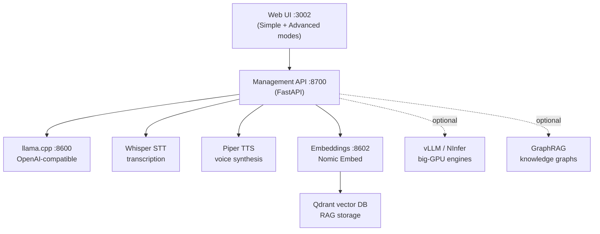

# Llama Nexus

> Your complete local AI platform — LLM chat, speech-to-text, text-to-speech,
> embeddings, and RAG in one self-managed web app. No cloud, no telemetry.

[](#quick-start)
[](#platform-support)
[](https://docker.com)
[](#api)

**Llama Nexus** deploys and manages a full local AI stack from a single web
UI: choose an LLM (llama.cpp — with optional vLLM/NInfer engines on big GPU
rigs), add voice (Whisper STT + Piper TTS), add knowledge (embeddings +
Qdrant vector DB + optional GraphRAG), then use it all together — chat by
voice with your documents as context. Everything runs on your machine and
exposes OpenAI-compatible endpoints for your other tools.

## Quick start

**Linux / macOS / WSL2:**
```bash
curl -fsSL https://raw.githubusercontent.com/alecKarfonta/llama-nexus/master/install.sh | bash
```

**Windows (PowerShell):**
```powershell
irm https://raw.githubusercontent.com/alecKarfonta/llama-nexus/master/install.ps1 | iex
```

The installer detects your hardware, picks the right prebuilt images, and
starts the stack. Then:

1. Open **http://localhost:3002** — the welcome wizard recommends a model
   matched to your hardware, downloads it, and deploys it automatically
2. Click **Get Started** — you land straight in **Chat**, ready to talk
3. Optional: enable **Voice mode** in Chat, or upload documents for RAG

Requirements: Docker (Engine or Desktop) + Compose v2, 8 GB+ RAM, 10 GB+
disk. NVIDIA GPU optional but transformative. Details:
**[docs/user/INSTALL.md](docs/user/INSTALL.md)**.

## Platform support

| Platform | Support | Notes |
|---|---|---|
| Linux + NVIDIA | Full | All engines (llama.cpp, vLLM, NInfer), GPU acceleration |
| Windows 10/11 | Full | Docker Desktop w/ WSL2; NVIDIA GPU passthrough supported |
| macOS (Apple Silicon M1/M2/M3) | CPU tier | Native arm64 `cpu` image (no emulation) — Docker VM has no GPU passthrough; use ≤4B models. Native Metal is on the roadmap |
| macOS (Intel) / CPU-only (any OS) | Works | Small models; see the [model guide](docs/user/MODEL_GUIDE.md) |

## What's inside



- **Chat** — streaming conversations with presets, model switching, and a
  fully-local voice loop (speak → transcribe → answer → speak back)
- **Models** — one-click downloads from the curated catalog or any
  HuggingFace GGUF repo, with hardware recommendations
- **Knowledge** — document ingestion (PDF/Office/text), chunking, embeddings,
  hybrid retrieval; optional GraphRAG with Neo4j knowledge graphs
- **Workflows** — visual multi-step LLM pipelines (Advanced mode)
- **Power tools** (Advanced mode) — fine-tuning, quantization, benchmarking,
  speculative decoding (MTP) research harnesses

## API

All inference endpoints are OpenAI-compatible:

```python
from openai import OpenAI

client = OpenAI(base_url="http://localhost:8600/v1", api_key="YOUR_API_KEY")
reply = client.chat.completions.create(
    model="local",
    messages=[{"role": "user", "content": "Hello!"}],
)
```

| Endpoint | Port | Use |
|---|---|---|
| `/v1/chat/completions`, `/v1/models` | 8600 | LLM (llama.cpp) |
| `/v1/embeddings` | 8602 | Embeddings (RAG) |
| `/v1/audio/transcriptions` | STT page | Speech-to-text |
| `/v1/audio/speech` | TTS page | Text-to-speech |
| `/api/v1/*` | 8700 | Management (service lifecycle, models, registry) |

The `API_KEY` is in your `.env` (generated by the installer).

## Configuration

Everything defaults sanely; the `.env` covers keys and image tiers, and the
web UI handles per-deploy tuning (context, sampling, GPU layers). See
[.env.example](.env.example) for annotated options.

Power users can relocate storage volumes
([storage override example](docker-compose.storage-override.yml.example)),
build llama.cpp from source with a matched CUDA arch
(`scripts/detect-cuda-arch.sh`), or layer GPU/rig compose overlays
([gpu](docker-compose.gpu.yml) · [rig](docker-compose.rig.yml)).

## Documentation

- [Install guide](docs/user/INSTALL.md) — per-OS setup, updates, uninstall
- [User guide](docs/user/USER_GUIDE.md) — chat, voice loop, RAG workflows
- [Model guide](docs/user/MODEL_GUIDE.md) — hardware→model matching
- [FAQ & troubleshooting](docs/user/FAQ.md)
- [Security notes](docs/user/SECURITY.md) — defaults, LAN exposure, data locations
- [Testing guide](docs/TESTING_GUIDE.md) · [Quantization guide](docs/quantization-user-guide.md) · [Dev docs](docs/)

## Contributing & development

```bash
git clone https://github.com/alecKarfonta/llama-nexus.git
cd llama-nexus
cp .env.example .env
docker compose -f docker-compose.yml -f docker-compose.gpu.yml up -d --build   # GPU hosts
```

Backend: FastAPI (`backend/`, pytest via `cd backend && pytest`). Frontend:
React + Vite (`frontend/`, `npm run dev`). CI runs tests + compose
portability checks on every PR.

## License

[MIT](LICENSE)
